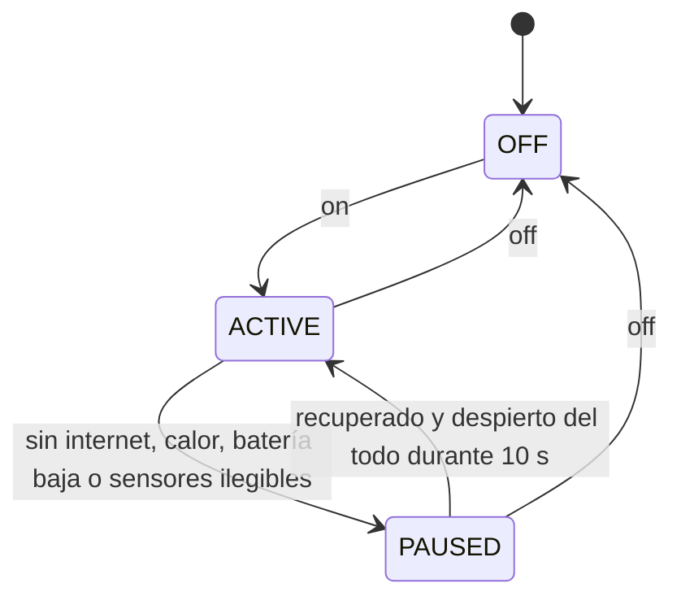

# agentmode

[English](README.md) | **Español**

> Sincronizado con v0.1.0. Si algo difiere, manda la versión en inglés.

Mantén despierto tu MacBook para los agentes de código (Claude Code, Codex o cualquier tarea larga), con la
tapa abierta o cerrada, y deja que vuelva a dormir solo cuando seguir despierto ya no sirve o es riesgoso.

[](https://github.com/ULookLookMe/agent-mode/actions/workflows/ci.yml)
[](https://github.com/ULookLookMe/agent-mode/releases)
[](LICENSE)


```sh
agentmode on    # cierra la tapa; tus agentes siguen trabajando
agentmode off   # vuelve el reposo normal
```

> [!WARNING]
> **Primero la seguridad.** Un MacBook que no puede dormir se puede calentar dentro de un morral. agentmode
> se pausa por calor, batería baja y falta de internet, pero hasta ahora se probó en vivo en **un solo** Mac.
> - Antes de guardar un Mac encendido en el morral, comprueba que `agentmode status` muestre temperaturas
>   reales y `Heat protection: full`.
> - Si algo sale mal, esto devuelve el reposo normal de inmediato: `sudo pmset -a disablesleep 0`
> - Lee [Seguridad](#seguridad) antes de confiar en él.

## Contenido

- [Qué hace](#qué-hace)
- [Requisitos](#requisitos)
- [Instalación](#instalación)
- [Uso diario](#uso-diario)
- [Un botón en la barra de menús](#un-botón-en-la-barra-de-menús)
- [Estado, registros y configuración](#estado-registros-y-configuración)
- [Seguridad](#seguridad)
- [Privacidad y red](#privacidad-y-red)
- [¿Por qué no caffeinate, Amphetamine o …?](#por-qué-no-caffeinate-amphetamine-o-)
- [Estado del proyecto](#estado-del-proyecto)
- [Solución de problemas](#solución-de-problemas)
- [Desinstalar](#desinstalar)
- [Cómo funciona](#cómo-funciona)
- [Contribuir](#contribuir)
- [Licencia](#licencia)

## Qué hace

- **Activo:** pone `SleepDisabled` en 1 (`pmset -a disablesleep 1`), así que el Mac no duerme, ni siquiera
  con la tapa cerrada y en batería. Al cerrar la tapa, apaga la pantalla interna en unos segundos, salvo que
  haya una pantalla externa en uso. El bloqueo de pantalla no cambia.
- **Se pausa solo** (vuelve el reposo normal y, con la tapa cerrada, el Mac se duerme):
  - 10 minutos seguidos sin internet;
  - calor: batería a 40 °C o más, promedio del chip a 80 °C o más durante 5 minutos, o estado térmico de
    macOS serio o crítico;
  - batería al 10 % o menos sin cargador;
  - con la tapa cerrada y sin pantalla externa, 2 minutos sin ningún sensor de temperatura legible.
- **Se reanuda solo**, pero únicamente con el Mac despierto del todo (tapa abierta, o tapa cerrada con una
  pantalla externa), nunca en un despertar de mantenimiento: vuelve internet, pasan 5 minutos de temperaturas
  en calma o conectas el cargador.
- **`off` es definitivo** hasta el siguiente `on`.

Nada de agentmode corre como root. Necesita una regla `sudoers` para exactamente dos comandos, `pmset -a
disablesleep 0` y `pmset -a disablesleep 1`, y el script de configuración la crea por ti.

## Requisitos

- Un MacBook con **Apple silicon** y **macOS 27** o posterior.
- Tu contraseña de administrador, una vez, para la regla `sudoers`.
- Para compilar desde el código: Swift 6.4 (Xcode 27, o las Command Line Tools con `xcode-select --install`).

## Instalación

Elige una opción. Cada una toma alrededor de un minuto y pide tu contraseña una vez.

### Una línea, sin herramientas de desarrollo

Abre **Terminal** y pega:

```sh
curl -fsSL https://github.com/ULookLookMe/agent-mode/releases/latest/download/install.sh | zsh
```

El script revisa tu Mac, descarga la última versión y verifica su checksum SHA-256. Instala `agentmode` en
`~/.local/bin`, te muestra la regla `sudoers` antes de crearla y arranca el proceso residente. También te
ofrece añadir `~/.local/bin` a tu `PATH`. Si quieres, [lee el script](scripts/install.sh) antes.

### Homebrew (compila desde el código)

```sh
brew install ulooklookme/tap/agentmode
zsh "$(brew --prefix)/share/agentmode/setup-privileges.sh"
```

Después de cada `brew upgrade agentmode`, ejecuta `agentmode install` para reiniciar el proceso residente con
el ejecutable nuevo.

### Desde el código

```sh
git clone https://github.com/ULookLookMe/agent-mode.git
cd agent-mode
swift build -c release
mkdir -p ~/.local/bin
install -m 0755 .build/release/agentmode ~/.local/bin/agentmode
zsh scripts/setup-privileges.sh --binary ~/.local/bin/agentmode
```

Usa `install`, nunca `cp`, para reemplazar el ejecutable. `cp` reescribe el archivo en su sitio y, a partir
de ahí, macOS mata cada ejecución (salida 137) mientras el proceso residente viejo sigue corriendo.

## Uso diario

```sh
agentmode on            # activa el modo
agentmode off           # lo apaga; queda apagado hasta el próximo on
agentmode toggle        # alterna (es lo que ejecuta el botón)
agentmode status        # muestra el estado
agentmode status --json # lo mismo, para scripts y apps
agentmode help          # todos los comandos
```

Las notificaciones te avisan cuando el modo se activa, se pausa (y por qué), se reanuda y se apaga. Siguen
el idioma de macOS: español si es tu primer idioma; si no, inglés.

Con el modo activo, cierra la tapa y sigue trabajando por SSH, o deja que Claude Code o Codex terminen.
`agentmode off` con la tapa cerrada duerme el Mac de inmediato, salvo que haya una pantalla externa en uso. Si
el modo se pausó con la tapa cerrada, solo se reanuda cuando abras la tapa (o con una pantalla externa),
aunque mientras tanto conectes el cargador.

## Un botón en la barra de menús

**Atajos** (viene con macOS):

1. Abre **Atajos** y crea un atajo llamado **Modo agente**.
2. Añade la acción **Ejecutar script de shell** ("Run Shell Script"), shell `zsh`, sin entrada, con la ruta
   que imprime `command -v agentmode`, por ejemplo:

   ```sh
   ~/.local/bin/agentmode toggle
   ```

3. En **Ajustes > Avanzado** de Atajos, activa **Permitir ejecutar scripts**. Esto deja que cualquier atajo
   ejecute scripts, así que añade solo atajos en los que confíes.
4. En los detalles del atajo, añade una combinación de teclas y activa **Fijar en la barra de menús**.

**SwiftBar o xbar** (muestra el estado como un ícono, con Activar/Apagar y las temperaturas): copia
[`extras/swiftbar/agentmode.10s.sh`](extras/swiftbar/agentmode.10s.sh) a tu carpeta de plugins y hazlo
ejecutable (`chmod +x`). Se refresca cada 10 segundos.

Para la v0.2 está prevista una app nativa de barra de menús, con botones de configuración y reparación para
quien no usa Terminal.

## Estado, registros y configuración

```text
$ agentmode status
Mode: active
Intent: on
SleepDisabled: 1
Lid: open
Internet: reachable
Thermal: nominal, pressure nominal
Battery temperature (max): 26.6 °C
Chip temperature (average): 34.5 °C
Power: battery, 59%
Last error: none
Heat protection: full
Heartbeat: 2026-10-17T00:30:46Z
Daemon: running
```

- `Mode` es `off`, `active` o `paused (motivos)`. `paused (waiting for full wake)` significa que todo se
  recuperó y espera a que abras la tapa.
- `SleepDisabled` es el valor real del sistema.
- `Heat protection` es `full` si se leen las temperaturas de la batería y del chip, `limited` si solo una y
  `none` si ninguna.
- `Daemon: running` significa que el proceso residente dio señal de vida en los últimos 2 minutos. Con
  `not running`, `Mode` dice `off`, porque nada aplica el modo.
- Cualquier línea `Warning:` al final necesita tu atención.

| Qué | Dónde |
|---|---|
| Registro | `~/Library/Logs/agentmode.log` (rota al llegar a 1 MB) |
| Salida de launchd | `~/Library/Logs/agentmode.stdout.log`, `agentmode.stderr.log` |
| Estado | `~/Library/Application Support/agentmode/` |
| Configuración (opcional) | `~/.config/agentmode/config.json` |

La configuración solo necesita las claves que quieras cambiar. Después de cambiarla, ejecuta
`agentmode install` para reiniciar el proceso residente.

| Clave | Por defecto |
|---|---|
| `internetTimeoutMinutes` | 10 |
| `probeIntervalSeconds` | 60 |
| `probeURLs` | `https://api.anthropic.com`, `https://captive.apple.com/hotspot-detect.html` |
| `thermalResumeMinutes` | 5 |
| `batteryFloorPercent` | 10 |
| `batteryMaxCelsius` | 40 |
| `dieAverageMaxCelsius` | 80 |
| `dieSustainMinutes` | 5 |
| `resumeMarginCelsius` | 5 |
| `allowUnknownTemperatures` | `false` |

Por ejemplo, si usas Codex quizá prefieras `{ "probeURLs": ["https://api.openai.com"] }`.

## Seguridad

- **Probado en un solo Mac.** La protección por calor lee sensores llamados `tdie` (chip) y `battery`,
  confirmados solo en un MacBook Pro M5. En otros chips pueden faltar: `status` muestra entonces
  `Heat protection: limited` (se lee uno de los dos, y el chequeo de calor usa ese más el estado térmico de
  macOS) o `none`, y una advertencia.
- **Sin sensores legibles, el modo se pausa.** Con la tapa cerrada y sin pantalla externa, agentmode se pausa
  tras 2 minutos sin ninguna temperatura legible, porque en las pruebas la señal térmica de macOS no reaccionó
  a 8 minutos de carga máxima. Pon `allowUnknownTemperatures` en `true` solo si aceptas ese riesgo.
- **Después de cada actualización de macOS**, comprueba que `agentmode status` siga mostrando temperaturas.
  Los sensores se leen con una API privada de macOS que una actualización puede cambiar.
- **Parada de emergencia:** `sudo pmset -a disablesleep 0` devuelve el reposo normal, con o sin agentmode.
  Compruébalo con `pmset -g | grep SleepDisabled`.
- **Si matan el proceso residente** (`kill -9`) con el modo activo, `SleepDisabled` queda en 1 hasta que
  launchd lo reinicia, lo que tarda unos segundos. Si no vuelve, `status` te avisa cuando el proceso residente
  lleva 2 minutos sin dar señal y `SleepDisabled` sigue en 1; `agentmode off` lo arregla.
- **Desinstala siempre como se indica** (ver [Desinstalar](#desinstalar)) antes de borrar el ejecutable o la
  regla `sudoers`.
- agentmode se entrega **tal cual, sin garantía** ([LICENSE](LICENSE)). Ver también [SECURITY.md](SECURITY.md).

## Privacidad y red

- Para detectar que se cayó la conexión, el proceso residente hace una petición `HEAD` a
  `https://api.anthropic.com` y una `GET` a `https://captive.apple.com/hotspot-detect.html`. Las hace cada 60
  segundos y cuando cambia la red, siempre que esté corriendo, aunque el modo esté apagado. Las peticiones no
  llevan datos tuyos ni usan cookies o caché. Cambia los hosts con `probeURLs`.
- Sin telemetría, sin analítica, sin cuentas. Todo el estado queda en los archivos de arriba.

## ¿Por qué no caffeinate, Amphetamine o …?

A octubre de 2026, estas son las herramientas más cercanas que conocemos:

| Herramienta | Tapa cerrada en batería, sin pantalla | Se pausa sola | Privilegios | Licencia |
|---|---|---|---|---|
| `caffeinate` (viene con macOS) | No: solo evita el reposo por inactividad | — | Ninguno | Incluido |
| [KeepingYouAwake](https://github.com/newmarcel/KeepingYouAwake), [Theine](https://apps.apple.com/app/theine/id955848755), [Lungo](https://sindresorhus.com/lungo) | No (Lungo solo con cargador y pantalla externa) | — | Ninguno | Varias |
| [Amphetamine](https://apps.apple.com/us/app/amphetamine/id937984704) | Sí, Closed-Display Mode | Batería baja | Script instalado con admin; complemento Power Protect en Apple silicon | Gratis |
| [Adrafinil](https://github.com/kageroumado/adrafinil) | Sí | El agente termina, calor, batería baja, temporizador | Helper root notarizado | MIT |
| [Keepresso](https://github.com/gyorgysh/keepresso) | Sí | Batería baja, calor | Helper de admin opcional | GPL-3.0 |
| [Sleepless](https://github.com/Aboudjem/Sleepless) | Sí | Batería baja, temporizador | La misma regla `sudoers` de dos comandos | MIT |
| [Hold My Lid](https://holdmylid.app/), [LidRun](https://lidrun.com/) | Sí | El agente termina / batería baja, presión térmica | Helper | De pago |
| **agentmode** | Sí | **Sin internet**, calor con **sensores reales** y macOS, batería baja, sensores ilegibles | Regla `sudoers` de dos comandos, sin helper | MIT |

agentmode te sirve si quieres que el modo se detenga cuando se cae la red, chequeos de calor basados en las
temperaturas reales de batería y chip, reanudación solo con el Mac despierto del todo (nunca dentro del
morral) y ningún helper con privilegios.

Elige otra herramienta si quieres que se detenga sola cuando tu agente termine (Adrafinil, Hold My Lid), una
app de barra de menús pulida desde ya (Keepresso, Adrafinil, Amphetamine), o soporte para macOS anterior al 27
o Macs Intel.

## Estado del proyecto

**v0.1, beta.** Probado en vivo en un MacBook Pro (M5, macOS 27.2): pasan el modo con la tapa cerrada, `off`
con la tapa cerrada, la autocuración, la pausa por batería y la instalación. Quedan cuatro pruebas en vivo
pendientes (sin internet, cerrar sesión, 30 minutos dormido tras una pausa, pantalla externa); su lógica la
cubren las pruebas unitarias. Los detalles están en [docs/testing.md](docs/testing.md), y las mediciones que
respaldan el diseño, en [docs/verified-facts.md](docs/verified-facts.md).

¿Lo probaste en otro Mac? Abre un issue [Tested on my Mac](https://github.com/ULookLookMe/agent-mode/issues/new?template=tested-on-my-mac.yml).

## Solución de problemas

- **`agentmode: command not found`.** `~/.local/bin` no está en tu `PATH`. Añade
  `export PATH="$HOME/.local/bin:$PATH"` a `~/.zprofile` y abre una ventana nueva de Terminal.
- **`Daemon: not running`.** Ejecuta `agentmode install`. Si macOS mostró "Se añadieron ítems en segundo
  plano", permite agentmode en **Ajustes del Sistema > General > Ítems de inicio**.
- **Falta la regla `sudoers`.** `off`, `install` y `uninstall` imprimen la línea exacta que necesitan; con
  `on`, el modo se apaga solo y `status` muestra el error en `Last error`. Vuelve a crear la regla con el
  instalador de una línea, `zsh "$(brew --prefix)/share/agentmode/setup-privileges.sh"` (Homebrew) o
  `zsh scripts/setup-privileges.sh` (desde un clon).
- **No aparecen notificaciones.** Las notificaciones se envían con `osascript`. Hay usuarios que reportan que
  macOS se las atribuye a **Editor de Scripts**, así que revisa **Ajustes del Sistema > Notificaciones > Editor
  de Scripts**. Es un reporte de la comunidad; Apple no lo documenta.
- **`Killed: 9` o salida 137 después de actualizar.** Se reemplazó el ejecutable con `cp`. Vuelve a copiarlo
  con `install -m 0755` y ejecuta `agentmode install`.
- **`Heat protection: limited` o `none`.** Los sensores de tu Mac tienen otros nombres. Reporta tu Mac con la
  plantilla de issue. Con `limited`, el chequeo de calor usa el sensor que sí se lee más el estado térmico de
  macOS. Con `none`, el modo se pausa tras 2 minutos con la tapa cerrada y sin pantalla externa, salvo que
  actives `allowUnknownTemperatures`.
- **El Mac sigue sin dormir.** `sudo pmset -a disablesleep 0`.

## Desinstalar

```sh
curl -fsSL https://github.com/ULookLookMe/agent-mode/releases/latest/download/install.sh | zsh -s -- --uninstall
```

Con Homebrew:

```sh
zsh "$(brew --prefix)/share/agentmode/setup-privileges.sh" --uninstall   # lo detiene, devuelve el reposo y borra la regla
brew uninstall agentmode
```

Desde un clon:

```sh
zsh scripts/setup-privileges.sh --uninstall --binary ~/.local/bin/agentmode
rm ~/.local/bin/agentmode
```

Opcional: borra `~/Library/Application Support/agentmode`, `~/.config/agentmode`,
`~/Library/Logs/agentmode*` y el atajo **Modo agente**.

## Cómo funciona



El proceso residente escucha la tapa, las pantallas, la energía, la red, el estado térmico y los sensores de
temperatura. Pasa esos eventos a una máquina de estados pura que decide cuándo poner `SleepDisabled` y cuándo
dormir el Mac. Reaplica el ajuste cada 30 segundos, porque macOS lo puede restablecer, y devuelve el reposo
normal al salir. [docs/architecture.md](docs/architecture.md) (en inglés) describe los estados, las señales,
las invariantes de seguridad y el contrato de `status --json` para integraciones.

## Contribuir

Los reportes de errores, los reportes de compatibilidad con otros Macs y los pull requests son bienvenidos.
Mira [CONTRIBUTING.md](CONTRIBUTING.md), el [Código de conducta](CODE_OF_CONDUCT.md) y, para
vulnerabilidades, [SECURITY.md](SECURITY.md).

Gracias a los mantenedores de Insomnia por la nota de que macOS puede restablecer `SleepDisabled`, y a
Vorssaint Utils (PR #1741) por descubrir que quitarlo con la tapa cerrada no duerme el Mac.

## Licencia

[MIT](LICENSE) © 2026 Juan Felipe Sánchez Gentil
