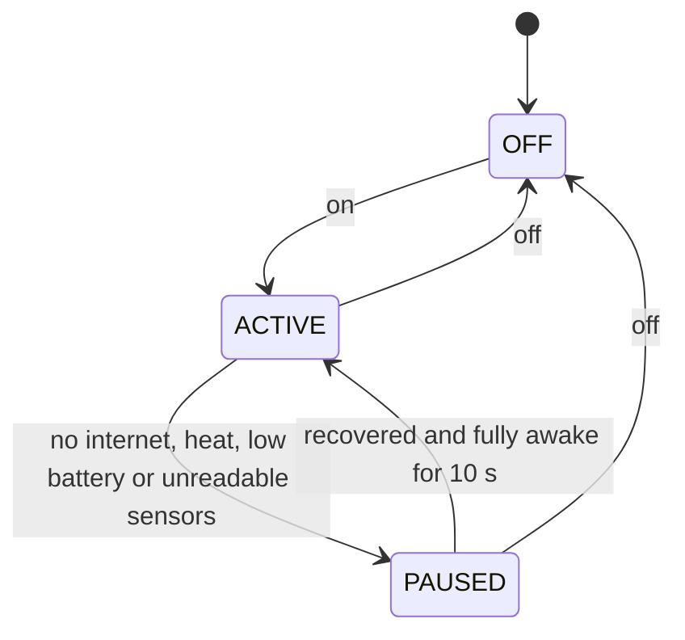

# agentmode

**English** | [Español](README.es.md)

Keep your MacBook awake for coding agents (Claude Code, Codex, any long job), with the lid open or closed,
and let it sleep again on its own when staying awake stops being useful or safe.

[](https://github.com/ULookLookMe/agent-mode/actions/workflows/ci.yml)
[](https://github.com/ULookLookMe/agent-mode/releases)
[](LICENSE)


```sh
agentmode on    # close the lid; your agents keep working
agentmode off   # back to normal sleep
```

> [!WARNING]
> **Safety first.** A MacBook that cannot sleep can get hot inside a bag. agentmode pauses on heat, low
> battery and lost internet, but it has been tested live on **one** Mac so far.
> - Before closing a running Mac in a bag, check that `agentmode status` shows real temperatures and
>   `Heat protection: full`.
> - If anything goes wrong, this restores normal sleep at once: `sudo pmset -a disablesleep 0`
> - Read [Safety](#safety) before relying on it.

## Contents

- [What it does](#what-it-does)
- [Requirements](#requirements)
- [Install](#install)
- [Daily use](#daily-use)
- [A button for the menu bar](#a-button-for-the-menu-bar)
- [Status, logs and configuration](#status-logs-and-configuration)
- [Safety](#safety)
- [Privacy and network](#privacy-and-network)
- [Why not caffeinate, Amphetamine or …?](#why-not-caffeinate-amphetamine-or-)
- [Project status](#project-status)
- [Troubleshooting](#troubleshooting)
- [Uninstall](#uninstall)
- [How it works](#how-it-works)
- [Contributing](#contributing)
- [License](#license)

## What it does

- **On:** sets `SleepDisabled` to 1 (`pmset -a disablesleep 1`), so the Mac does not sleep, even with the lid
  closed on battery. When you close the lid, it turns the internal display off within seconds, unless an
  external display is in use. Screen lock does not change.
- **Pauses on its own** (normal sleep comes back, and with the lid closed the Mac goes to sleep):
  - 10 minutes in a row without internet;
  - heat: battery at 40 °C or more, chip average at 80 °C or more for 5 minutes, or macOS thermal state
    serious or critical;
  - battery at 10 % or less without the charger;
  - with the lid closed and no external display, no readable temperature sensor for 2 minutes.
- **Resumes on its own**, but only when the Mac is fully awake (lid open, or lid closed with an external
  display), never during a maintenance wake: internet is back, 5 minutes of calm temperatures, or the charger
  is connected.
- **`off` means off** until the next `on`.

Nothing in agentmode runs as root. It needs one `sudoers` rule for exactly two commands, `pmset -a
disablesleep 0` and `pmset -a disablesleep 1`, and the setup script creates it for you.

## Requirements

- A MacBook with **Apple silicon** and **macOS 27** or later.
- An administrator password, once, for the `sudoers` rule.
- To build from source: Swift 6.4 (Xcode 27, or the Command Line Tools from `xcode-select --install`).

## Install

Pick one. Each takes about a minute and asks for your password once.

### One line, no developer tools

Open **Terminal** and paste:

```sh
curl -fsSL https://github.com/ULookLookMe/agent-mode/releases/latest/download/install.sh | zsh
```

The script checks your Mac, downloads the latest release and verifies its SHA-256 checksum. It installs
`agentmode` into `~/.local/bin`, creates the `sudoers` rule after showing it to you, and starts the
background process. It also offers to add `~/.local/bin` to your `PATH`. [Read the script](scripts/install.sh)
first if you like.

### Homebrew (builds from source)

```sh
brew install ulooklookme/tap/agentmode
zsh "$(brew --prefix)/share/agentmode/setup-privileges.sh"
```

After each `brew upgrade agentmode`, run `agentmode install` to restart the background process with the new
binary.

### From source

```sh
git clone https://github.com/ULookLookMe/agent-mode.git
cd agent-mode
swift build -c release
mkdir -p ~/.local/bin
install -m 0755 .build/release/agentmode ~/.local/bin/agentmode
zsh scripts/setup-privileges.sh --binary ~/.local/bin/agentmode
```

Use `install`, never `cp`, to replace the binary. `cp` rewrites the file in place, and macOS then kills every
run of it (exit 137) while the old background process keeps running.

## Daily use

```sh
agentmode on            # turn the mode on
agentmode off           # turn it off; it stays off until the next on
agentmode toggle        # switch (this is what the button runs)
agentmode status        # show the state
agentmode status --json # the same, for scripts and apps
agentmode help          # every command
```

Notifications tell you when the mode turns on, pauses (and why), resumes and turns off. They follow your
macOS language: English, or Spanish when Spanish is your first language.

With the mode on, close the lid and keep working over SSH, or let Claude Code or Codex finish. `agentmode off`
with the lid closed puts the Mac to sleep right away, unless an external display is in use. If the mode
paused with the lid closed, it resumes only when you open the lid (or use an external display), even if you
connect the charger in the meantime.

## A button for the menu bar

**Shortcuts** (built into macOS):

1. Open **Shortcuts** and create a shortcut named **Agent mode**.
2. Add the **Run Shell Script** action, shell `zsh`, no input, with the path that `command -v agentmode`
   prints, for example:

   ```sh
   ~/.local/bin/agentmode toggle
   ```

3. In Shortcuts **Settings > Advanced**, turn on **Allow Running Scripts**. This lets every shortcut run
   scripts, so only add shortcuts you trust.
4. In the shortcut's details, add a keyboard shortcut and turn on **Pin in Menu Bar**.

**SwiftBar or xbar** (shows the state as an icon, with On/Off and the temperatures):
copy [`extras/swiftbar/agentmode.10s.sh`](extras/swiftbar/agentmode.10s.sh) into your plugin folder and make
it executable (`chmod +x`). It refreshes every 10 seconds.

A native menu bar app, with setup and repair buttons for people who don't use Terminal, is planned for v0.2.

## Status, logs and configuration

```text
$ agentmode status
Mode: active
Intent: on
SleepDisabled: 1
Lid: open
Internet: reachable
Thermal: nominal, pressure nominal
Battery temperature (max): 26.6 °C
Chip temperature (average): 34.5 °C
Power: battery, 59%
Last error: none
Heat protection: full
Heartbeat: 2026-10-17T00:30:46Z
Daemon: running
```

- `Mode` is `off`, `active` or `paused (reasons)`. `paused (waiting for full wake)` means everything
  recovered and it waits for you to open the lid.
- `SleepDisabled` is the live system value.
- `Heat protection` is `full` when the battery and chip temperatures are readable, `limited` when only one
  is, and `none` when neither is.
- `Daemon: running` means the background process reported in the last 2 minutes. With `not running`, `Mode`
  says `off`, because nothing applies the mode.
- Any `Warning:` line at the end needs your attention.

| What | Where |
|---|---|
| Log | `~/Library/Logs/agentmode.log` (rotates at 1 MB) |
| launchd output | `~/Library/Logs/agentmode.stdout.log`, `agentmode.stderr.log` |
| State | `~/Library/Application Support/agentmode/` |
| Configuration (optional) | `~/.config/agentmode/config.json` |

The configuration only needs the keys you change. After a change, run `agentmode install` to restart the
background process.

| Key | Default |
|---|---|
| `internetTimeoutMinutes` | 10 |
| `probeIntervalSeconds` | 60 |
| `probeURLs` | `https://api.anthropic.com`, `https://captive.apple.com/hotspot-detect.html` |
| `thermalResumeMinutes` | 5 |
| `batteryFloorPercent` | 10 |
| `batteryMaxCelsius` | 40 |
| `dieAverageMaxCelsius` | 80 |
| `dieSustainMinutes` | 5 |
| `resumeMarginCelsius` | 5 |
| `allowUnknownTemperatures` | `false` |

For example, Codex users may prefer `{ "probeURLs": ["https://api.openai.com"] }`.

## Safety

- **Tested on one Mac.** The heat protection reads sensors named `tdie` (chip) and `battery`, confirmed only on
  a MacBook Pro M5. On other chips they may be missing: `status` then shows `Heat protection: limited` (one of
  the two is readable, and heat checks use it plus macOS's thermal state) or `none`, and a warning.
- **Unreadable sensors pause the mode.** With the lid closed and no external display, agentmode pauses after 2
  minutes without any readable temperature, because macOS's own thermal signal did not react to 8 minutes of
  full load in testing. Set `allowUnknownTemperatures` to `true` only if you accept that risk.
- **After every macOS update**, check that `agentmode status` still shows temperatures. The sensors are read
  through a private macOS API that an update can change.
- **Emergency stop:** `sudo pmset -a disablesleep 0` restores normal sleep, with or without agentmode. Check it
  with `pmset -g | grep SleepDisabled`.
- **If the background process is killed** (`kill -9`) while the mode is on, `SleepDisabled` stays at 1 until
  launchd restarts it, which takes a few seconds. If it does not come back, `status` warns you once the
  background process has been silent for 2 minutes and `SleepDisabled` is still 1; `agentmode off` fixes it.
- **Always uninstall properly** (see [Uninstall](#uninstall)) before deleting the binary or the `sudoers`
  rule.
- agentmode is provided **as is, without warranty** ([LICENSE](LICENSE)). See also [SECURITY.md](SECURITY.md).

## Privacy and network

- To notice a lost connection, the background process sends a `HEAD` request to `https://api.anthropic.com`
  and a `GET` request to `https://captive.apple.com/hotspot-detect.html`. It sends them every 60 seconds and
  when the network changes, whenever it runs, even with the mode off. The requests carry no data about you
  and use no cookies or cache. Change the hosts with `probeURLs`.
- No telemetry, no analytics, no accounts. All state stays in the files listed above.

## Why not caffeinate, Amphetamine or …?

As of October 2026, these are the closest tools we know of:

| Tool | Lid closed on battery, no display | Pauses on its own | Privileges | License |
|---|---|---|---|---|
| `caffeinate` (built in) | No: it only prevents idle sleep | — | None | Built in |
| [KeepingYouAwake](https://github.com/newmarcel/KeepingYouAwake), [Theine](https://apps.apple.com/app/theine/id955848755), [Lungo](https://sindresorhus.com/lungo) | No (Lungo only with a charger and an external display) | — | None | Various |
| [Amphetamine](https://apps.apple.com/us/app/amphetamine/id937984704) | Yes, Closed-Display Mode | Low battery | Admin-installed script; Power Protect add-on on Apple silicon | Free |
| [Adrafinil](https://github.com/kageroumado/adrafinil) | Yes | Agent finished, heat, low battery, timer | Notarized root helper | MIT |
| [Keepresso](https://github.com/gyorgysh/keepresso) | Yes | Low battery, heat | Optional admin helper | GPL-3.0 |
| [Sleepless](https://github.com/Aboudjem/Sleepless) | Yes | Low battery, timer | The same two-command `sudoers` rule | MIT |
| [Hold My Lid](https://holdmylid.app/), [LidRun](https://lidrun.com/) | Yes | Agent finished / low battery, thermal pressure | Helper | Paid |
| **agentmode** | Yes | **No internet**, heat from **real sensors** and macOS, low battery, unreadable sensors | Two-command `sudoers` rule, no helper | MIT |

agentmode is a good fit when you want the mode to stop when the network drops, heat checks based on real
battery and chip temperatures, resumes only on a full wake (never inside a bag), and no privileged helper.

Pick something else if you want it to stop by itself when your agent finishes (Adrafinil, Hold My Lid), a
polished menu bar app today (Keepresso, Adrafinil, Amphetamine), or support for macOS older than 27 or Intel
Macs.

## Project status

**v0.1, beta.** Tested live on one MacBook Pro (M5, macOS 27.2): closed-lid mode, `off` with the lid closed,
self-healing, battery pause and installation pass. Four live checks are still pending (no internet, log out,
30 minutes asleep after a pause, external display); unit tests cover their logic. Details are in
[docs/testing.md](docs/testing.md), and the measurements behind the design are in
[docs/verified-facts.md](docs/verified-facts.md).

Did you try it on another Mac? Please open a [Tested on my Mac](https://github.com/ULookLookMe/agent-mode/issues/new?template=tested-on-my-mac.yml)
issue.

## Troubleshooting

- **`agentmode: command not found`.** `~/.local/bin` is not on your `PATH`. Add
  `export PATH="$HOME/.local/bin:$PATH"` to `~/.zprofile` and open a new Terminal window.
- **`Daemon: not running`.** Run `agentmode install`. If macOS showed "Background Items Added", allow
  agentmode in **System Settings > General > Login Items**.
- **The `sudoers` rule is missing.** `off`, `install` and `uninstall` print the exact line they need; with
  `on`, the mode turns itself off and `status` shows the error under `Last error`. Create the rule again with
  the one-line installer, `zsh "$(brew --prefix)/share/agentmode/setup-privileges.sh"` (Homebrew) or
  `zsh scripts/setup-privileges.sh` (from a clone).
- **No notifications.** Notifications are sent with `osascript`. Users report that macOS attributes them to
  **Script Editor**, so check **System Settings > Notifications > Script Editor**. This is a community report,
  not documented by Apple.
- **`Killed: 9` or exit 137 after updating.** The binary was replaced with `cp`. Copy it again with
  `install -m 0755` and run `agentmode install`.
- **`Heat protection: limited` or `none`.** Your Mac's sensors have different names. Please report your Mac
  with the issue template. With `limited`, heat checks use the sensor that reads plus macOS's thermal state.
  With `none`, the mode pauses after 2 minutes with the lid closed and no external display, unless you set
  `allowUnknownTemperatures`.
- **The Mac still won't sleep.** `sudo pmset -a disablesleep 0`.

## Uninstall

```sh
curl -fsSL https://github.com/ULookLookMe/agent-mode/releases/latest/download/install.sh | zsh -s -- --uninstall
```

With Homebrew:

```sh
zsh "$(brew --prefix)/share/agentmode/setup-privileges.sh" --uninstall   # stops it, restores sleep, removes the rule
brew uninstall agentmode
```

From a clone:

```sh
zsh scripts/setup-privileges.sh --uninstall --binary ~/.local/bin/agentmode
rm ~/.local/bin/agentmode
```

Optional: delete `~/Library/Application Support/agentmode`, `~/.config/agentmode`,
`~/Library/Logs/agentmode*` and the **Agent mode** shortcut.

## How it works



The background process listens to the lid, displays, power, network, thermal state and temperature sensors,
and feeds those events into a pure state machine that decides when to set `SleepDisabled` and when to put the
Mac to sleep. It reapplies the setting every 30 seconds, because macOS can reset it, and restores normal sleep
when it exits. [docs/architecture.md](docs/architecture.md) covers the states, signals, safety invariants
and the `status --json` contract for integrations.

## Contributing

Bug reports, Mac compatibility reports and pull requests are welcome. See [CONTRIBUTING.md](CONTRIBUTING.md),
the [Code of Conduct](CODE_OF_CONDUCT.md), and [SECURITY.md](SECURITY.md) for vulnerabilities.

Thanks to the Insomnia maintainers for the note that macOS can reset `SleepDisabled`,
and to Vorssaint Utils (PR #1741) for the finding that clearing it with the lid closed does not put the Mac to
sleep.

## License

[MIT](LICENSE) © 2026 Juan Felipe Sánchez Gentil
