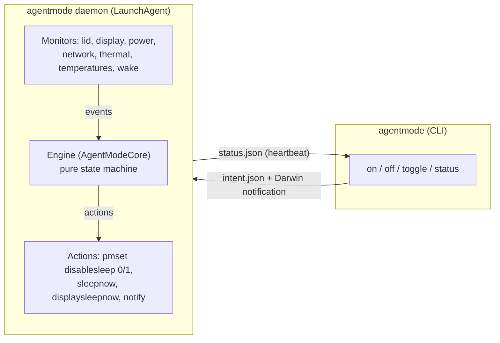
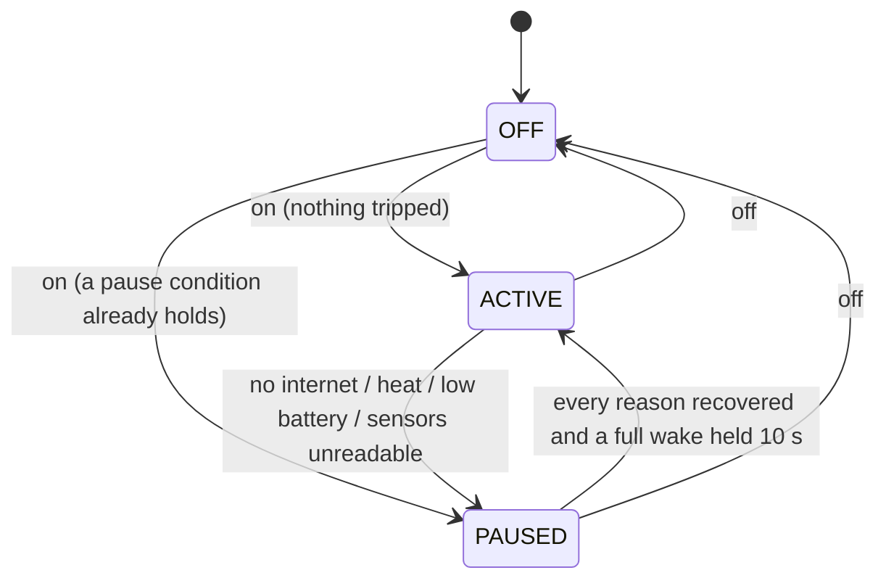

# Architecture

agentmode is one Swift executable with two roles: a short-lived **CLI** (`on`, `off`, `toggle`, `status`,
`install`, `uninstall`) and a long-lived **background process** (`agentmode daemon`) that launchd keeps
running in your login session. The decisions live in a pure library, `AgentModeCore`, with unit tests.
The executable only reads the system and carries out the actions that library returns.



## Components

| Part | Where | What it does |
|---|---|---|
| `AgentModeCore` | `Sources/AgentModeCore` | The `Engine` state machine, CLI parsing and planning, `StatusView`, notification texts, configuration and install-path rules. Pure, with unit tests. |
| `agentmode` | `Sources/agentmode` | Monitors (lid, external display, power, network, thermal state, temperatures, full wake), the daemon loop, state files, launchd install and `pmset` calls. |
| `CIOHIDPrivate` | `Sources/CIOHIDPrivate` | Declarations of the private `IOHIDEventSystemClient` functions used to read temperatures. Weak-linked, so agentmode still starts if macOS removes them. |
| LaunchAgent | `~/Library/LaunchAgents/com.jsanchez.agentmode.plist` | Runs `agentmode daemon` with `RunAtLoad` and `KeepAlive` in the GUI session (`LimitLoadToSessionType: Aqua`). |

## States



- **OFF:** you turned it off or never turned it on. `SleepDisabled` is 0.
- **ACTIVE:** `SleepDisabled` is 1, so the Mac does not sleep, even with the lid closed.
- **PAUSED(reasons):** you want it on, but a safety condition paused it. `SleepDisabled` is 0. `PAUSED()`
  with no reasons means everything recovered and the mode waits for a full wake.

`toggle` turns an OFF mode on and an ACTIVE or PAUSED mode off. A manual `off` stays off until the next `on`.

## Pause and resume rules

| Reason | Pauses when | Recovers when |
|---|---|---|
| `noInternet` | No probe succeeds for `internetTimeoutMinutes` (10) | The first probe succeeds |
| `thermal` | Battery ≥ `batteryMaxCelsius` (40 °C); chip average ≥ `dieAverageMaxCelsius` (80 °C) for `dieSustainMinutes` (5); or macOS thermal state serious/critical, or pressure heavy or higher | `thermalResumeMinutes` (5) of calm: battery and chip `resumeMarginCelsius` (5 °C) below their limits and macOS nominal or fair |
| `lowBattery` | On battery at `batteryFloorPercent` (10 %) or less | The charger is connected |
| `sensorsUnavailable` | Lid closed, no external display, and no temperature sensor readable for 2 minutes (unless `allowUnknownTemperatures`) | A sensor is readable again, the lid opens, or an external display is connected |

A pause restores normal sleep. With the lid closed and no external display, it also runs `pmset sleepnow`,
because clearing `disablesleep` with the lid closed does not put the Mac to sleep by itself.

A pause resumes only during a **full wake**: the system reports the graphics capability and the lid is open
or an external display is in use, held for 10 seconds. A maintenance wake (DarkWake) with the lid closed
never resumes the mode.

## Safety invariants

These hold in every change; the tests in `Tests/AgentModeCoreTests` pin them.

- **A1.** `SleepDisabled` never stays at 1 after `off`, after a pause, when the background process exits,
  or after `uninstall`. `off` restores it from the CLI too, in case the daemon is down.
- **A2.** A closed Mac does not heat up unchecked: heat, low battery and unreadable sensors pause the mode.
- **A3.** No password prompt on each change: the `sudoers` rule covers the two commands.
- **A4.** No privileges beyond `pmset -a disablesleep 0` and `pmset -a disablesleep 1`, and no third-party
  privileged software.
- **A5.** An external display in use is never turned off, and a Mac used in clamshell mode with one is
  not put to sleep.
- **A6.** The mode never resumes during a maintenance wake with the lid closed.

## Signals

- **Lid:** `IOPMrootDomain` clamshell notifications, plus `AppleClamshellState` at startup.
- **Internet:** `NWPathMonitor` for path changes, plus a probe every `probeIntervalSeconds` (60) and on each
  change. The probe sends `HEAD` to `https://api.anthropic.com` (any HTTP answer counts) and `GET` to
  `https://captive.apple.com/hotspot-detect.html` (counts only with HTTP 200 and "Success", so a captive
  portal does not count), with a 10-second timeout. Redirects are not followed.
- **Heat:** every 30 s, real temperatures from `IOHIDEventSystemClient` (usage page `0xff00`, usage 5).
  Readings outside −20…150 °C are discarded. Battery is the maximum of sensors whose name contains
  "battery"; chip is the average of sensors whose name contains "tdie". Also `ProcessInfo.thermalState` and
  `com.apple.system.thermalpressurelevel`.
- **Battery:** `IOPowerSources` change notifications.
- **Full wake:** the `System Capabilities` graphics bit of `IOPMrootDomain`, the lid and external displays.
- **Self-heal:** every 30 s the daemon compares `SleepDisabled` with the state and fixes it, because macOS can
  reset it.

## Integration contract

Use this contract to build on agentmode (a menu bar app, a SwiftBar plugin, a script).

**Read the state with `agentmode status --json`.** It prints one JSON object. Every key is always present,
and unknown values are `null`.

```json
{
  "batteryMaxCelsius" : 31.2,
  "batteryPercent" : 73,
  "chipAverageCelsius" : 42.5,
  "daemonRunning" : true,
  "heartbeatAt" : "2026-10-17T00:30:46Z",
  "heatProtection" : "full",
  "intent" : "on",
  "internetReachable" : true,
  "lastError" : null,
  "lidClosed" : false,
  "mode" : "active",
  "onBattery" : false,
  "pauseReasons" : [],
  "schemaVersion" : 1,
  "sleepDisabled" : true,
  "thermalLevel" : "nominal",
  "thermalPressure" : 0,
  "version" : "0.1.0",
  "waitingForFullWake" : false,
  "warnings" : []
}
```

| Key | Values |
|---|---|
| `schemaVersion` | `1`. A breaking change bumps it. |
| `mode` | `off`, `active` or `paused`. `off` whenever the daemon is not running. |
| `pauseReasons` | Any of `noInternet`, `thermal`, `lowBattery`, `sensorsUnavailable`. |
| `waitingForFullWake` | `true` when paused with every reason recovered. |
| `intent` | `on` or `off`: the last thing you asked for. |
| `daemonRunning` | `true` when the daemon wrote a heartbeat less than 2 minutes ago and has not stopped. |
| `sleepDisabled` | The live kernel value, read at that moment. |
| `heatProtection` | `full` (battery and chip readable), `limited` (one readable) or `none`. |
| `warnings` | Human-readable warnings: `SleepDisabled` is 1 while the daemon is not running, or heat protection is limited. |

**Change the state with the CLI** (`agentmode on`, `off`, `toggle`). Do not write the state files
yourself: `off` also restores `SleepDisabled` from the CLI when the daemon is down (A1), and only the CLI
does that.

**Internal files** (they can change between versions): `~/Library/Application Support/agentmode/intent.json`
(your last `on`/`off`), `status.json` (the daemon's snapshot and heartbeat), and the Darwin notification
`user.uid.<uid>.com.jsanchez.agentmode.changed`, which the CLI posts after writing the intent.

## Configuration

`~/.config/agentmode/config.json` only needs the keys you change. An invalid file falls back to the defaults
and logs one line. The daemon reads it at startup, so run `agentmode install` after a change.

| Key | Default |
|---|---|
| `internetTimeoutMinutes` | 10 |
| `probeIntervalSeconds` | 60 |
| `probeURLs` | `https://api.anthropic.com`, `https://captive.apple.com/hotspot-detect.html` |
| `thermalResumeMinutes` | 5 |
| `batteryFloorPercent` | 10 |
| `batteryMaxCelsius` | 40 |
| `dieAverageMaxCelsius` | 80 |
| `dieSustainMinutes` | 5 |
| `resumeMarginCelsius` | 5 |
| `allowUnknownTemperatures` | `false` |
